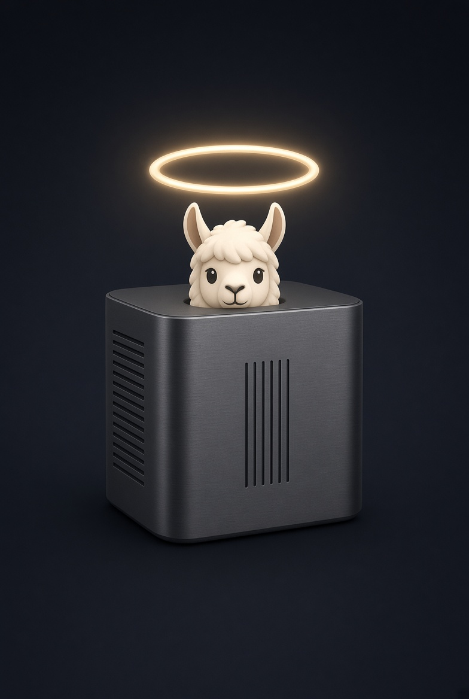
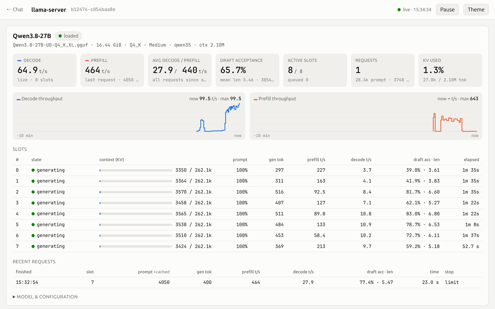
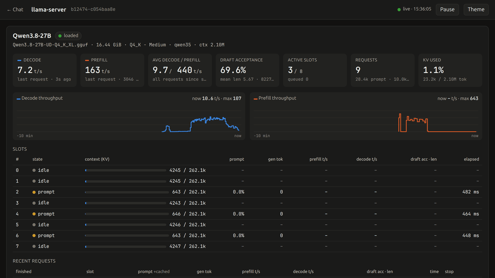
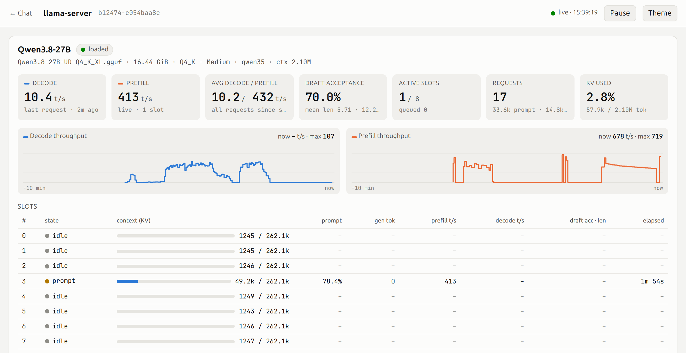
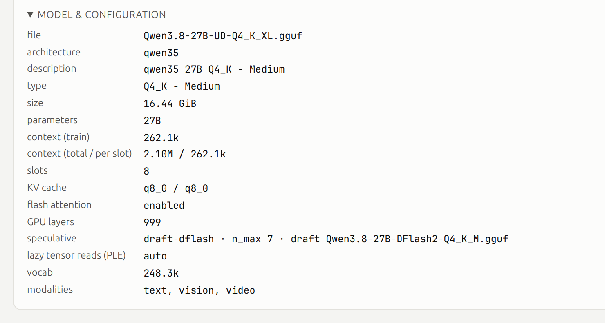

<p align="center"></p>

<h1 align="center">Qwen3.8-27B on AMD Strix Halo</h1>

This recipe serves Qwen3.8-27B (dense, 27B) from one 128 GB AMD Strix Halo through an OpenAI-compatible API. Eight
requests run at once, each with the model's full 262,144-token context, and z-lab's DFlash2 drafter speeds up decode.
It uses the official [strix-llama.cpp](https://github.com/halo-box/strix-llama.cpp) images, so nothing is built on
your machine.

## At a glance

| | Vulkan (default) | ROCm (`BACKEND=rocm`) |
| --- | ---: | ---: |
| Requests at once, each with a 262,144-token window | 8 | 6 |
| Decode, one request (prose / code) | 18.2 / 51.3 tok/s | 17.6 / 39.6 tok/s |
| Decode, all requests together (prose / code) | 47.2 / 94.5 tok/s (8) | 47.6 / 97.1 tok/s (6) |
| Prefill, 32k / 128k-token prompt | 440 / 321 tok/s | 337 / 211 tok/s |
| GPU memory under full load | 102.4 GiB | 86.7 GiB |

The numbers come from [sparkDash](https://github.com/MiaAI-Lab/sparkDash), the benchmark that
[Mia's AI Lab](https://github.com/MiaAI-Lab) uses for its DGX Spark recipes, on a GMKtec EVO-X2 (Ryzen AI Max+ 395).
[Performance](#performance) has every table and the method.

<picture>
  <source media="(prefers-color-scheme: dark)" srcset="media/dashboard-dark.png">
  
</picture>

The server's own dashboard (`/dashboard`) at the defaults on Vulkan. Eight code requests generate at once at 99.5
tok/s together. The request before them shows in the list: a 4,050-token prompt prefilled at 464 tok/s, then decoded
at 27.9 tok/s. The model accepted 77% of the DFlash2 drafts.

## Quick start

You need a Strix Halo with 128 GB, Linux with Docker, and about 25 GB of free disk.

```bash
git clone https://github.com/halo-box/Qwen3.8-27B-Strix-Halo-strix-llama.git
cd Qwen3.8-27B-Strix-Halo-strix-llama
./setup.sh      # checks the host and offers to fix it; kernel parameter changes need a reboot
./start.sh      # BACKEND=rocm ./start.sh for ROCm
```

The first start downloads the model (about 18.4 GiB into `~/models/qwen38-27b`), checks each file against Hugging
Face's sha256, pulls the engine image and loads the model. A download that stops resumes where it left off. When the
smoke test passes, `start.sh` prints `Qwen3.8-27B is now LIVE on http://127.0.0.1:8080/v1`. Later starts take about
15 seconds.

## Using the server

```bash
curl -s http://127.0.0.1:8080/v1/chat/completions -H 'Content-Type: application/json' -d '{
  "model": "Qwen3.8-27B",
  "messages": [{"role": "user", "content": "Write a Python fibonacci function."}],
  "max_tokens": 2000
}'
```

Any OpenAI client works with `base_url="http://127.0.0.1:8080/v1"` and the model `Qwen3.8-27B`. Streaming and tool
calls work. The model thinks before it answers and returns that text as `reasoning_content`, so give replies enough
`max_tokens`, or send `"chat_template_kwargs": {"enable_thinking": false}`. The server samples with the model's own
defaults (temperature 1.0, top-p 0.95, top-k 20). Values in a request override them.

```bash
./start.sh restart                     # after changing a setting; a bad setting leaves the running server alone
./start.sh --print                     # print the docker command and exit
./stop.sh                              # stop the server and free the GPU memory
docker logs -f qwen38-27b-strix        # server log
```

### Images

The model's own vision tower is on by default. `VISION=0` turns it off. Send images as OpenAI content parts:

```bash
IMG=$(base64 -w0 photo.jpg)
curl -s http://127.0.0.1:8080/v1/chat/completions -H 'Content-Type: application/json' -d '{
  "model": "Qwen3.8-27B",
  "messages": [{"role": "user", "content": [
    {"type": "image_url", "image_url": {"url": "data:image/jpeg;base64,'"$IMG"'"}},
    {"type": "text", "text": "What is in this picture?"}]}],
  "max_tokens": 2000
}'
```

### Ports and serving other machines

| Port | What | Listens on | Set with |
| --- | --- | --- | --- |
| 8080/tcp | the API (`/v1`), `/dashboard`, `/metrics`, `/health` | `127.0.0.1` | `PORT`, `HOST` |
| 5555/tcp | sparkDash, only while `bench/sparkdash.py` runs | `127.0.0.1` | nothing to set |

Nothing else listens. By default only the machine itself can reach the server. To serve other machines, set an API
key and the address to listen on, then restart:

```bash
API_KEY=$(openssl rand -hex 24) HOST=0.0.0.0 ./start.sh restart     # or put both in .env
```

Clients then send `Authorization: Bearer <API_KEY>`. `/health` answers without the key.

Docker publishes the port with its own firewall rules, which come before ufw (Ubuntu) and firewalld (Fedora). So in
the usual setup the port is open as soon as `HOST` allows it, and a ufw or firewalld rule neither opens nor closes it.
To limit who can connect, set `HOST` to one of the machine's addresses, or add a rule to Docker's `DOCKER-USER`
chain. This one allows only the local network (change `192.168.0.0/16` to yours):

```bash
sudo iptables -I DOCKER-USER -p tcp --dport 8080 ! -s 192.168.0.0/16 -j DROP
```

A `DOCKER-USER` rule is lost at reboot. To keep it, save it with your distro's tool, such as `iptables-persistent`
on Debian and Ubuntu.

If Docker does not manage the firewall (`"iptables": false` in `/etc/docker/daemon.json`), open the port yourself:

```bash
sudo ufw allow from 192.168.0.0/16 to any port 8080 proto tcp                         # ufw
sudo firewall-cmd --permanent --add-rich-rule='rule family=ipv4 source address=192.168.0.0/16 port port=8080 protocol=tcp accept' \
    && sudo firewall-cmd --reload                                                        # firewalld
```

### Dashboard and metrics

`http://<host>:8080/dashboard` is the server's own dashboard. It shows decode and prefill speed live and over the
last ten minutes, draft acceptance, each request's progress and KV use, the last requests and the configuration. It
asks for the API key when one is set. `http://<host>:8080/metrics` serves the same counters to Prometheus.

Eight code requests arriving at once, 30 seconds. The prompts prefill at up to 719 tok/s, then all eight generate at
about 96 tok/s together:

<p align="center"></p>

A long prompt three quarters through its prefill, at 410 tok/s. The bar shows 47.1k of the request's 262.1k window:

<picture>
  <source media="(prefers-color-scheme: dark)" srcset="media/long-prompt-dark.png">
  
</picture>

The configuration the server reports, which is the recipe's: eight 262.1k windows, a q8_0 KV cache, and DFlash2
with up to seven drafts:

<picture>
  <source media="(prefers-color-scheme: dark)" srcset="media/configuration-dark.png">
  
</picture>

## Performance

These are the defaults: 8 × 262,144-token windows on Vulkan and 6 on ROCm, a q8_0 KV cache, DFlash2 with adaptive
drafts. The machine is a GMKtec EVO-X2 (Ryzen AI Max+ 395, 128 GB) on Ubuntu 26.04 with kernel 7.0.0-43, 107 GiB of
GTT, `amd_iommu=off` and the tuned `accelerator-performance` profile. sparkDash ran on the same machine, with the same
settings as the [Flash-Next recipe](https://github.com/halo-box/Qwen3.8-Flash-Next-Strix-Halo-llama#performance) and
Mia's Qwen3.8 recipes, so the numbers compare with theirs:

- Prose runs at temperature 0.7 with thinking on. Code runs at temperature 0 with thinking off, and each stream gets
  a different Python task.
- Each stream generates 400 tokens. Every decode run repeats three times, and the tables show the median.
- Per request is the mean of each stream's `(completion_tokens - 1) / (time of the last token - time of the first)`.
  Time to first token is not part of it.
- Aggregate counts every stream's decode tokens over the window from the first stream's first token to the last
  stream's last token. It is not the sum of the per-request speeds.
- TTFT is the mean time to the first token, measured by the client.
- Prefill sends a cold prompt with a unique prefix each run. Its speed is llama-server's own prompt timing, and the
  token count includes the chat template.

Drafts only pay off when the model accepts them, so decode speed depends on the text: code, which repeats much of
what the model has seen, decodes almost three times faster than prose. A number from another benchmark compares only
with the same prompts, sampling and thinking setting. A single run at two to four requests varies by up to 15%,
which is why each run repeats. `bench/sparkdash.py` runs the benchmark (see [Benchmarks](#benchmarks)).

### Vulkan (default, 8 × 262k)

#### Decode, prose

| Concurrent requests | Aggregate | Per request | TTFT |
| ---: | ---: | ---: | ---: |
| 1 | 18.2 tok/s | 18.2 tok/s | 147 ms |
| 2 | 26.0 tok/s | 13.1 tok/s | 238 ms |
| 4 | 32.1 tok/s | 8.2 tok/s | 521 ms |
| 8 | 47.2 tok/s | 6.4 tok/s | 1,361 ms |

#### Decode, code

| Concurrent requests | Aggregate | Per request | TTFT |
| ---: | ---: | ---: | ---: |
| 1 | 51.3 tok/s | 51.3 tok/s | 171 ms |
| 2 | 46.7 tok/s | 24.0 tok/s | 310 ms |
| 4 | 46.0 tok/s | 12.3 tok/s | 908 ms |
| 8 | 94.5 tok/s | 13.3 tok/s | 1,565 ms |

#### Prefill, cold prompts

| Prompt tokens | Prefill | TTFT |
| ---: | ---: | ---: |
| 4,137 | 489 tok/s | 8.48 s |
| 8,231 | 486 tok/s | 16.95 s |
| 16,422 | 472 tok/s | 34.83 s |
| 32,803 | 440 tok/s | 74.60 s |
| 65,574 | 390 tok/s | 168.00 s |
| 131,109 | 321 tok/s | 407.96 s |

### ROCm (6 × 262k)

#### Decode, prose

| Concurrent requests | Aggregate | Per request | TTFT |
| ---: | ---: | ---: | ---: |
| 1 | 17.6 tok/s | 17.6 tok/s | 224 ms |
| 2 | 21.9 tok/s | 11.7 tok/s | 314 ms |
| 4 | 30.9 tok/s | 8.4 tok/s | 548 ms |
| 6 | 47.6 tok/s | 8.5 tok/s | 1,083 ms |

#### Decode, code

| Concurrent requests | Aggregate | Per request | TTFT |
| ---: | ---: | ---: | ---: |
| 1 | 39.6 tok/s | 39.6 tok/s | 373 ms |
| 2 | 39.8 tok/s | 20.4 tok/s | 315 ms |
| 4 | 88.2 tok/s | 25.1 tok/s | 669 ms |
| 6 | 97.1 tok/s | 17.5 tok/s | 819 ms |

#### Prefill, cold prompts

| Prompt tokens | Prefill | TTFT |
| ---: | ---: | ---: |
| 4,134 | 389 tok/s | 10.64 s |
| 8,229 | 385 tok/s | 21.41 s |
| 16,422 | 368 tok/s | 44.61 s |
| 32,804 | 337 tok/s | 97.33 s |
| 65,574 | 284 tok/s | 230.96 s |
| 131,114 | 211 tok/s | 622.17 s |

ROCm batches better than Vulkan at two to six requests (code at four: 88.2 against 46.0 tok/s), and at full load the
two are even (six requests on ROCm, 47.6 / 97.1 tok/s; eight on Vulkan, 47.2 / 94.5). Vulkan decodes one request
faster (code 51.3 against 39.6), prefills 25 to 50% faster, and fits two more full windows, so it is the default. For
a few clients that mostly write code with short prompts, `BACKEND=rocm` is the faster choice.

### Against one DGX Spark

Mia's [TensorFold recipe](https://github.com/MiaAI-Lab/Qwen3.8-27B-DGX-Spark-TensorFold) serves the same model on one
DGX Spark with the same drafter, eight requests and full windows, and reports the same sparkDash benchmark:

| sparkDash | This recipe, Vulkan | TensorFold, 1 × DGX Spark |
| --- | ---: | ---: |
| Decode, prose, 1 / 8 requests (aggregate) | 18.2 / 47.2 tok/s | 58.3 / 220.6 tok/s |
| Decode, code, 1 / 8 requests (aggregate) | 51.3 / 94.5 tok/s | 136.9 / 323.2 tok/s |
| Prefill, 8k / 32k / 128k | 486 / 440 / 321 tok/s | 1,793 / 1,633 / 1,118 tok/s |

Prefill is bound by matrix compute, and the Spark has about four times as much (about 100 TFLOPS against 26 here).
Decode is bound by memory, and both machines read it at about the same speed (256 GB/s here, 273 on the Spark), so
that gap is in the engine: TensorFold verifies a tree of DFlash2 drafts, llama.cpp one draft chain, and on Vulkan two
to four requests decode together little faster than one.

## Memory

GTT is the part of the machine's RAM that the kernel lets the GPU use. `bench/memory.sh` measured these (UD-Q4_K_XL,
DFlash2 and vision on, ubatch 2048, the buffers the server reports and the GTT in use once loaded):

| Backend, KV cache | Requests × window | Model | KV, recurrent state, draft KV | Compute | GTT once loaded |
| --- | --- | ---: | ---: | ---: | ---: |
| Vulkan, q8_0 | 1 × 262,144 | 16.5 GiB | 9.7 GiB | 8.8 GiB | 31.6 GiB |
| Vulkan, q8_0 | 4 × 262,144 | 16.5 GiB | 38.8 GiB | 8.8 GiB | 60.8 GiB |
| Vulkan, q8_0 | 8 × 262,144 (default) | 16.5 GiB | 77.7 GiB | 9.0 GiB | 99.9 GiB |
| ROCm, q8_0 | 1 × 262,144 | 16.5 GiB | 9.7 GiB | 9.6 GiB | 32.1 GiB |
| ROCm, q8_0 | 4 × 262,144 | 16.5 GiB | 38.8 GiB | 15.5 GiB | 64.2 GiB |
| ROCm, f16 | 1 × 262,144 | 16.5 GiB | 17.2 GiB | 7.8 GiB | 38.8 GiB |

The model and its draft take 16.5 GiB on the GPU, and the vision tower 0.9 GiB more. Only 16 of the model's 64 layers
are attention layers; the others are Gated DeltaNet layers with a fixed-size state. So a 262,144-token window costs
9.7 GiB with a q8_0 KV cache, recurrent state and draft KV included, and 17.2 GiB with f16. On Vulkan the compute
buffers stay at 9 GiB from one to eight requests. On ROCm they grow by about 2 GiB a request, so fewer requests fit.
The memory plan in `start.sh` uses these figures (`MODEL_GIB`, `COMPUTE_GIB`, `KV_GIB_PER_262K`).

Under full load the server takes more than once loaded, because Vulkan fills its memory pages as prompts grow. With
eight requests at once, each with about 196k tokens, GTT peaked at 102.4 GiB, and the lowest usable RAM
(`MemAvailable` minus `CmaFree`) was 4.2 GiB. That is enough for the host and little else. On a machine that also runs
other services, serve seven requests (`PARALLEL=7`), which leaves about 14 GiB.

`start.sh` refuses a configuration that needs more than the smallest of three limits:

- the GTT limit minus 2 GiB
- `MemTotal` minus 10 GiB (Mia's DGX Spark recipe keeps 9 GiB free)
- `MemTotal` minus `CmaFree` minus 6 GiB

The last limit matters on kernels that type free RAM as CMA without reserving a CMA area: GPU pages cannot use CMA
blocks. The [Flash-Next recipe](https://github.com/halo-box/Qwen3.8-Flash-Next-Strix-Halo-llama#memory) found and
measured it; `./setup.sh` warns when it finds CMA-free memory. Shorter windows fit more requests: set
`CONTEXT_PER_SLOT`, or `auto` for the largest window that fits `PARALLEL` requests.

## Configuration

Settings live in [`scripts/config.sh`](scripts/config.sh). Override them in the environment (`PARALLEL=4 ./start.sh`)
or in a `.env` file next to `start.sh`. `start.sh` reads `.env` as `KEY=value` lines and never runs it. Arguments
after `--` go to `llama-server` last (`./start.sh restart -- --verbose`), and `start.sh` passes on every `LLAMA_ARG_*`
variable.

| Variable | Default | Meaning |
| --- | --- | --- |
| `BACKEND` | `vulkan` | `vulkan` or `rocm`. The image and the memory figures follow it |
| `IMAGE` | per backend | the engine image |
| `SERVER_BIN` | none | the path of `llama-server` in an `IMAGE` whose entrypoint is something else |
| `MODEL_DIR` | `~/models/qwen38-27b` | where the model files are, or where they download to |
| `HOST` / `PORT` / `API_KEY` | `127.0.0.1` / `8080` / none | set `API_KEY` before `HOST=0.0.0.0` |
| `PARALLEL` | `8` (Vulkan), `6` (ROCm) | requests served at once, each with its own window; `auto` serves as many as fit |
| `CONTEXT_PER_SLOT` | `262144` | tokens each request may use, prompt and reply; `auto` picks the largest window that fits `PARALLEL` requests |
| `KV_DTYPE` | `q8_0` | KV cache type |
| `UBATCH` | `2048` | prompt batch size |
| `DRAFT` | `dflash` | `dflash` (z-lab's DFlash2), `mtp` (unsloth's MTP head) or `none` |
| `DRAFT_N` / `DRAFT_FILE` | `7` / per draft | draft length and file; `DRAFT=mtp` takes 3 and `mtp-Qwen3.8-27B-Q4_0.gguf` |
| `DRAFT_ADAPTIVE` | `1` | size each draft from measured acceptance instead of always drafting `DRAFT_N` |
| `SPEC_DRAFT_MAX_SLOTS` | `0` | draft only while at most this many requests generate; 0 drafts always |
| `VISION` | `1` | image input |
| `TEMPERATURE` / `TOP_P` / `TOP_K` / `MIN_P` | `1.0` / `0.95` / `20` / `0` | default sampling, the model's own |
| `CTX_CHECKPOINTS` / `CACHE_RAM` | `4` / `0` | per-request state checkpoints and the host prompt cache; both grow host RAM over time |

### What `start.sh` does

1. `scripts/prepare.sh` downloads any missing model file and pulls the engine image.
2. The memory plan works out what the configuration takes on the GPU and refuses one that does not fit. The error
   says how many requests would fit.
3. `start.sh` checks the arguments with `llama-server` in a throwaway container, so a typo leaves a running server
   alone. It refuses to start while another `llama-server` runs.
4. While the model loads, `start.sh` shows the memory loaded so far. It kills the server at once if GTT passes the
   budget or the host's usable memory drops under 4 GiB.
5. One chat completion runs as a smoke test, then the LIVE message appears.

`FOREGROUND=1 ./start.sh` stays attached to the server's log and exits with its exit code, for a systemd unit.

## How the defaults were chosen

Each row comes from a sparkDash run on this machine, with one request, a 262,144-token window, Vulkan, a q8_0 KV
cache and ubatch 2048, unless the row says otherwise. Decode is the median of three runs, prose / code.

| Choice | Measured | Kept |
| --- | --- | --- |
| A draft | no draft 12.5 / 12.5 tok/s, the release's 12.5 | a draft |
| DFlash2, not the MTP head | DFlash2, 7 drafts: 20.8 / 53.1 tok/s. MTP with 2 / 3 / 4 / 5 / 6 drafts: 21.3 / 30.1, 20.8 / 35.9, 20.0 / 40.4, 18.4 / 43.9, 18.1 / 45.0. Both cost prefill alike: 484 (DFlash2) and 480 (MTP) tok/s at 8k against 507 without a draft | DFlash2 |
| 7 DFlash2 drafts | 5 drafts: 21.0 / 47.8 tok/s. 7 is the most its block of 8 allows | 7 |
| The Q4_K_M drafter, not Q8_0 | Q8_0: 19.2 / 52.4 tok/s, and 0.9 GB more | Q4_K_M |
| ubatch 2048 | Vulkan, prefill at 8k / 32k: 472 / 429 tok/s with 1024, 484 / 442 with 2048, 456 / 419 with 4096. ROCm: 385 / 338 with 2048, 386 / 338 with 4096 | 2048, as in the release recipe |
| Vulkan as the default | Vulkan prefills 484 / 442 tok/s at 8k / 32k, ROCm 385 / 338. ROCm's compute buffers grow with each request, so fewer fit | Vulkan |
| q8_0 KV | half of f16 per window (9.7 against 17.2 GiB), which is what fits eight 262k windows. Quality: see [Checks](#checks) | q8_0 |
| Eight requests, each with a 262k window | they fit on Vulkan (99.9 GiB loaded, see [Memory](#memory)). Drafting always, aggregate at 1 / 2 / 4 / 8 requests: prose 17.6 / 18.5 / 25.0 / 39.3, code 51.5 / 47.7 / 46.1 / 98.0 tok/s. Mia's TensorFold recipe serves eight by default too | 8 on Vulkan; 6 on ROCm, the most that fit |
| Draft at every load (`SPEC_DRAFT_MAX_SLOTS=0`) | Vulkan, 8 requests, aggregate prose / code: 39.3 / 98.0 tok/s drafting always, 52.7 / 53.0 with `--spec-draft-max-slots 4`, 61.5 / 61.6 with no draft. The draft costs prose under load and doubles code | 0, always |
| Adaptive drafts | Vulkan, 8 requests, aggregate at 1 / 2 / 4 / 8: prose 20.0 / 23.2 / 24.7 / 46.0 tok/s adaptive against 17.6 / 18.5 / 25.0 / 39.3 fixed; code 50.3 / 47.4 / 46.7 / 98.0 against 51.5 / 47.7 / 46.1 / 98.0. One request: 21.1 / 51.0 against 20.8 / 53.1. One sweep each, so a single row varies by up to 15% | on |
| `--no-spec-draft-backend-sampling` | AgentionAI's model cards: drafting on the backend skips min-p for accepted drafts, and a repetition can run away when a client sends min-p | on |

## Checks

All of these pass on the machine above at the defaults, with the pinned images:

| Check | Vulkan, 8 × 262k | ROCm, 6 × 262k |
| --- | --- | --- |
| `tests/check.py`: chat, streaming, a required tool call, image input | ok | ok |
| A prompt of exactly 262,144 tokens gets HTTP 400 | ok | ok |
| `--window`: 262,131 prompt + 13 reply tokens fill the window, and the last prompt chunk is a partial tile | served in 1,139 s | served in 1,952 s |
| `--long`: every request at about 196k tokens (3/4 of its window) at once | 8 × 196k in 5,729 s | 6 × 196k in 7,223 s |
| GTT peak and lowest usable RAM (`MemAvailable - CmaFree`) under that load | 102.4 / 4.2 GiB | 86.7 / 24.3 GiB |
| amdgpu or OOM errors in the kernel log | none | none (one `amdkfd` workqueue CPU-time warning) |

What the q8_0 KV cache costs, measured as Mia's TensorFold recipe measures its FP8 cache (`bench/quality.sh`: 4
sequences of 4,096 tokens of wikitext-2 and 4 of CPython source, against an f16 cache, same weights):

| Corpus | KL of q8_0 to f16 | Top-1 agreement |
| --- | ---: | ---: |
| wikitext-2 | 0.00018 | 99.73% |
| CPython source | 0.00002 | 99.87% |

TensorFold reports a KL of 0.0031 and 98.7% top-1 agreement for its FP8 cache on the same kind of test.

```bash
python3 tests/check.py              # chat, streaming, tool call, image, a prompt the size of the window refused
python3 tests/check.py --window     # also a request that fills the window exactly
python3 tests/check.py --long 8     # also 8 requests at once, each with 3/4 of a window (more than an hour)
tests/host_test.sh                  # GPU detection against fake KFD topologies, no GPU needed
tests/bootloader_test.sh            # setup.sh's kernel parameter step on each boot loader, in containers
```

### Tested hardware

| Host | Distro, kernel | GTT | Result |
| --- | --- | --- | --- |
| GMKtec EVO-X2 (Ryzen AI Max+ 395, 128 GB) | Ubuntu 26.04, 7.0.0-43 | 107 GiB | every check above |

Some parts are tested without the hardware. `tests/host_test.sh` finds the gfx1151 among other GPUs through KFD's
topology. `tests/bootloader_test.sh` runs the kernel parameter step on rpm-ostree, kernelstub, grubby, Debian and
Arch GRUB, extlinux and systemd-boot. `./setup.sh` installed the missing tools and Docker with the distro's package
manager in Debian 13, Ubuntu 26.04, Fedora 44, Arch and openSUSE Tumbleweed containers.

Other vendors' Strix Halo machines, 64 GB machines, other distros and kernels on real hardware, and a second GPU in
the same machine are not tested yet. The memory plan reads each host's own GTT limit, `MemTotal` and `CmaFree`, so a
host with less memory gets a smaller budget: on 64 GB, `PARALLEL=auto` serves the requests that fit. To add a host,
open an issue with the output of `./setup.sh --check`, `./start.sh` and `python3 tests/check.py --window`.

## Requirements

- Any Strix Halo (Ryzen AI Max, gfx1151), from any vendor. 128 GB is tested; on 64 GB fewer requests fit. A second
  GPU, such as an eGPU or a discrete card, can stay in. The recipe finds the gfx1151 through KFD and gives the
  container only its render node.
- The BIOS UMA or dedicated graphics memory set to its minimum. The GPU uses GTT, and a carve-out takes memory from
  it.
- GTT raised to `MemTotal` minus 10 GiB (`ttm.pages_limit`, `amdgpu.gttsize`) and `amd_iommu=off`. `./setup.sh`
  works out the values from your RAM and asks before it adds them. It knows rpm-ostree (Bazzite, Silverblue),
  kernelstub (Pop!_OS), grubby (Fedora), GRUB (Debian, Ubuntu, Arch), extlinux (Alpine) and systemd-boot. For other
  boot loaders, add the parameters by hand.
- Linux with the amdgpu driver. Kernel 7.0 (Ubuntu 26.04) is tested; older kernels are not.
- Docker, with your user in the `docker` group, and `bash`, `curl`, `python3`, `sha256sum` and `pgrep` on the host.
  `./setup.sh` installs what is missing with apt-get, dnf, pacman or zypper, and asks first. On Alpine:
  `apk add bash curl python3 docker`.
- About 25 GB of free disk for the model files, plus the engine image: 0.3 GiB (Vulkan) or 8.6 GiB (ROCm).

## Benchmarks

```bash
python3 bench/sparkdash.py --label vulkan --clients 1,2,4,8   # against the running server
bench/sweep.sh bench/plans/readme.txt                         # restart with each configuration, then measure
bench/memory.sh bench/plans/memory-vulkan.txt                 # what each configuration takes on the GPU
bench/quality.sh                                              # what the q8_0 KV cache costs against f16
```

`bench/sparkdash.py` starts sparkDash (`sparkdash:da20ac5`) in a container on the host network, registers this
machine as a local unit and runs the benchmarks through sparkDash's API. The first run builds the image from
sparkDash's commit `da20ac5b4940bd9ff349fdb020e32252dd71fa21`. Results go to `results/sparkdash/<label>.md` and
`.json`. `bench/plans/` holds every plan behind the tables here. `bench/quality.sh` downloads wikitext-2-raw-v1
(the copy llama.cpp's perplexity scripts use, checked against its sha256) unless you give it `wiki.test.raw`.

## Notes

- Never load with `--load-mode mmap` on this hardware. On Vulkan, a later load in the same boot can fail with
  `Couldn't update BO_VA (-12)` in `dmesg`, and the GPU driver can hang until a reboot. On ROCm, KFD refuses it. The
  recipe reads the weights with `--load-mode none`.
- After many hours of GPU work in the same boot, a large load can fail with `Couldn't update BO_VA (-12)`, or leave
  the server stuck in the kernel: `start.sh` stops at a fixed percentage of the load, the process is in state `D`, GTT
  stays held and `dmesg` shows `llama-server ... blocked for more than 120 seconds`. A reboot fixes it.
- Do not start a configuration past the memory plan (`FORCE=1`) on Vulkan. Vulkan fills GTT pages as it first
  touches them, after any allocation check. Near the GTT limit, the kernel then kills host services before anything
  can stop it. ROCm refuses an allocation that does not fit.

These three come from the [Flash-Next recipe](https://github.com/halo-box/Qwen3.8-Flash-Next-Strix-Halo-llama#notes),
which ran into each of them on this machine.

## Repository layout

| Path | Contents |
| --- | --- |
| `setup.sh` | host checks and fixes: GPU, BIOS carve-out, host tools, Docker, kernel, GTT parameters, tuned |
| `start.sh` / `stop.sh` | serve and stop |
| `scripts/config.sh` | every setting, with `.env` and environment overrides |
| `scripts/prepare.sh` | model download and sha256 check, image pull |
| `scripts/host.sh` | finds the gfx1151 (render node, GTT counters) through KFD's topology |
| `tests/check.py` | checks against the running server |
| `tests/host_test.sh` | `scripts/host.sh` against fake topologies, no GPU needed |
| `tests/bootloader_test.sh` | `setup.sh`'s kernel parameter step on each boot loader, in throwaway containers |
| `bench/sparkdash.py`, `bench/sweep.sh`, `bench/memory.sh`, `bench/quality.sh`, `bench/plans/` | speed, memory and quality measurements |

## Credits

[CREDITS.md](CREDITS.md) lists where each file, setting and idea came from. The engine and its images come from
[halo-box/strix-llama.cpp](https://github.com/halo-box/strix-llama.cpp), built on
[llama.cpp](https://github.com/ggml-org/llama.cpp). The model is Qwen's, quantized by [Unsloth](https://unsloth.ai);
the drafter is [z-lab](https://huggingface.co/z-lab)'s DFlash2. The benchmark is
[sparkDash](https://github.com/MiaAI-Lab/sparkDash), and the comparison and the quality check follow Mia's
[TensorFold recipe](https://github.com/MiaAI-Lab/Qwen3.8-27B-DGX-Spark-TensorFold). The scripts start from the
[Flash-Next recipe](https://github.com/halo-box/Qwen3.8-Flash-Next-Strix-Halo-llama), host setup follows
[claudejaune/Qwen3.8-Halogen-Flash-Strix-Halo](https://github.com/claudejaune/Qwen3.8-Halogen-Flash-Strix-Halo), and
the shape of this repository follows [Mia's AI Lab](https://github.com/MiaAI-Lab).
